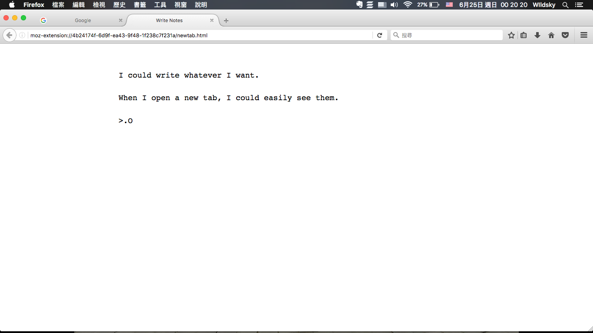

# Tab Notes
Open a new tab and write anything.

## Features:

* **Easy-to-use**: Just open new tab, and write down thoughts.
* **Auto-save**: No worries about saving things when writing.
* **Theme**: Support light and dark theme.
* **Lightweight and fast**
* **Multiple notes**: Create as many notes as you like.
* **Browser-action with shortcut**: You could use it without changing your current new tab page.
* **Customization**: Edit font, font size and more.
* **Images**: Paste images in your notes.
* **Styled text**: Make your text bold, italic or underlined.
* **Links**: Paste links to websites
* Open-source

## Shortcuts

- `Ctrl/Cmd + U`: To open the browser-action tab notes.

## Download

Tab Notes is available to the following browsers:
* [Firefox](https://addons.mozilla.org/firefox/addon/tab-notes/)
* [Chrome](https://chrome.google.com/webstore/detail/tab-notes/obnnegakmgonaiplaobihpmcjhlceeic)

## Screenshot

## Development

The extension has no build step: load this folder as an unpacked or temporary extension.

- Lint (also runs on every push): `npx web-ext@10 lint`
- Package for both stores: `npx web-ext@10 build`, which writes `dist/tab_notes-<version>.zip`. `web-ext-config.mjs` lists the files left out of the package.
- Tests: `cd tests && npm install && npm test`. They build the package first, then check it in Chromium and check the upgrade from 3.2.0 in a local Firefox 140+ (set `FIREFOX_BIN` if Firefox is not in `/Applications`).
